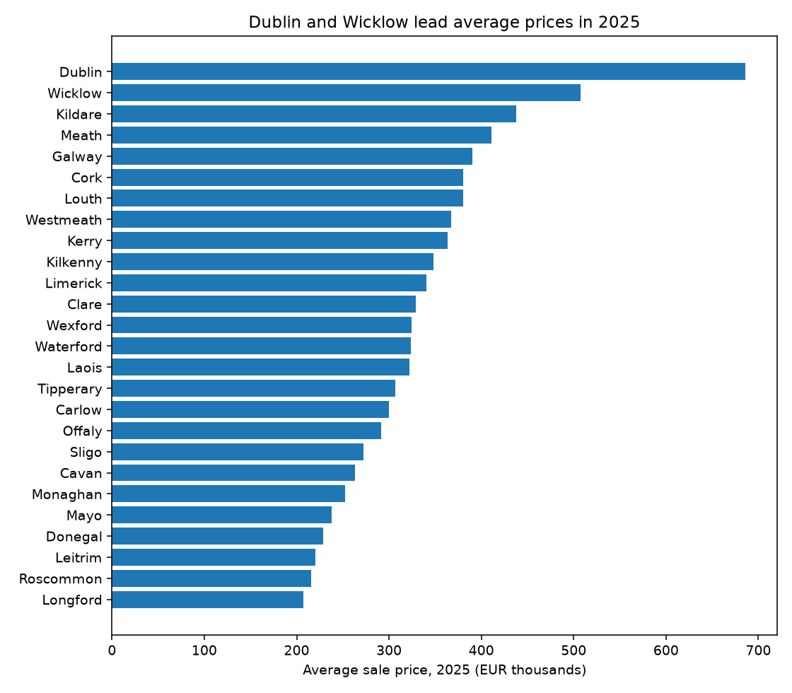

# Irish Property Prices in Excel (2024–2025)

An Excel workbook built on the official Property Price Register: 116,321 full-market-price sales across Ireland's 26 counties in 2024 and 2025. Everything in the summary is a live formula, so it updates if the data changes.



## What's inside `irish_property_2024_2025.xlsx`

| Sheet | What it does | Excel skills |
|---|---|---|
| **Data** | One row per sale: date, year, county, region, price, new or second-hand. Filters and frozen header. | AutoFilter, number formats |
| **Regions** | County to region lookup table | Lookup table design |
| **Summary** | Sales count, average price, year-on-year change, sales over €500k and new-build share for every county | COUNTIFS, AVERAGEIFS, multi-condition criteria, % formats, bar chart |
| **Notes** | What each formula does, plus a PivotTable exercise | Documentation |

The region column uses `XLOOKUP`, with an `INDEX/MATCH` fallback so it works in older Excel versions too.

## Findings

- National average sale price rose from **€437,262 (2024) to €459,163 (2025)**, about +5%.
- **Dublin**: 18,495 sales in 2025, average €686,038, and 8,137 sales over €500k.
- **Leitrim** had the lowest average (€220,229) but one of the biggest rises (+16.9%).
- **Wicklow's average fell 18.8%**, but that's mostly because fewer very expensive homes sold, not a market crash. Dublin's 2025 median (€475,000) is far below its average (€686,038), which shows how much a few large sales pull averages up.

## Limitations

- Averages are sensitive to a small number of very expensive sales; medians tell a steadier story.
- New-build prices in the register exclude VAT, so they're not directly comparable with second-hand prices.
- Only full-market-price sales are included.

## Rebuild it

```bash
pip install pandas openpyxl
python build_workbook.py
```

Needs `PPR-ALL.csv` from [propertypriceregister.ie](https://www.propertypriceregister.ie). Open the workbook in Excel to calculate the formulas.

Data: Property Services Regulatory Authority, Residential Property Price Register.
